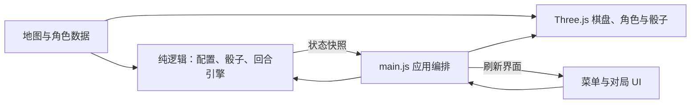

# 口袋大富翁

软件工程课程项目：Three.js + Vite + 原生 JavaScript，纯前端实现，无后端、外部模型或在线 AI 服务。

**当前为第④阶段：地产、随机事件、起点奖励、税收、监狱、变卖清偿、破产与排名已实现。AI 自动决策及音效打磨尚未实现。**

## 运行

建议使用 Node.js 22.12+；开发验证环境为 Windows、Node.js 24.13.1。

```bash
npm ci
npm run dev
npm test
npm run build
```

打开终端显示的 Local 地址，默认端口 5173；端口占用时可能递增。`npm run preview` 可预览 dist 中的生产构建。首次安装需要网络，游戏运行无需下载模型或纹理。浏览器需要支持 WebGL 2。

## 操作方式

1. 在大厅选地图、2–4 名玩家、角色与 5–100 回合上限。
2. 点击集结出发进入棋盘；所有棋子从起点出发，同格棋子有不同站位。
3. 点击掷骰子：骰子滚动后，角色按点数逐格跳跃，镜头平滑跟随；可关闭镜头跟随。
4. 落到无主地产后选择购买或放弃，落到他人地产自动支付租金。点击「地产与地契」可查看归属、各级租金并升级自己的房屋。落格处理完成后才能结束回合，每位玩家行动一次才增加一轮。
5. 确认事件弹窗后继续；达到回合上限或仅剩一名玩家时展示资产排名。返回大厅会清除本局进度，保留最近配置；刷新页面不保存进度。

本阶段 AI 座位仍由玩家手动代操作。欠款自动变卖清偿；破产玩家退出后，其他玩家继续。

## 架构



core 不导入 DOM 或 Three.js。规则层先确定点数和路径，渲染层按此结果播放动画，每步完成后再提交位置。单一回合状态机与动作令牌拒绝重复、越序和过期回调。页面切换销毁旧引擎、动画与容器，避免旧事件积累。

## 功能与代码对照

| 功能 | 文件 / 关键函数 |
| --- | --- |
| 配置默认值、校验、人数和角色交换 | `src/core/config.js`：createDefaultConfig、validateConfig、setPlayerCount、selectCharacter |
| 游戏初始状态 | `src/core/state.js`：createGameState |
| 主题与角色描述 | `src/data/maps.js`、`src/data/characters.js` |
| 三套真实棋盘、格子坐标与类型 | `src/data/boards.js`：createBoard、TILE_TYPES |
| 地价、产权、租金、升级、总资产 | `src/core/property.js`：propertyTerms、createProperties、buyProperty、collectRent、upgradeProperty、totalAssets |
| 随机事件卡 | `src/core/event.js`：drawEvent |
| 变卖、支付与破产 | `src/core/bankrupt.js`：saleValue、settlePayment |
| 最终资产排名 | `src/core/result.js`：rankPlayers |
| 特殊格、事件确认、跳过回合、终局 | `src/core/engine.js`：resolveTile、acknowledge、endTurn、finish |
| 事件弹窗与胜负结算 | `src/ui/outcome.js`：mountOutcome |
| 购买决策与升级权限 | `src/core/engine.js`：resolveProperty、decideProperty、upgrade |
| 购买弹窗与地契 | `src/ui/deed.js`：mountDeeds；`src/property.css` |
| 产权颜色与房屋等级 | `src/render/board.js`：syncProperties |
| 骰子点数、循环路径 | `src/core/dice.js`：rollDice、movementPath |
| 防连掷、移动确认、落格、回合上限 | `src/core/engine.js`：TurnEngine |
| 大厅与配置交互 | `src/ui/menu.js`：mountMenu |
| 对局信息、落格说明、日志、退出确认 | `src/ui/game.js`：mountGame |
| 代码构建 Q 版角色 | `src/render/character.js`：createCharacter |
| 共享主题场景与资源释放 | `src/render/preview.js`：WorldPreview |
| 骰面绘制与结果朝向 | `src/render/dice.js`：createDice、diceOrientation |
| 跳跃、跟随、动画取消 | `src/render/board.js`：BoardView.hop、roll、cancelAnimations、dispose |
| 页面切换、异步动作协调 | `src/main.js`：showMenu、showGame |
| 界面样式 | `src/styles.css`、`src/game.css` |
| 边界测试与回合验证 | `tests/config.test.js`、`tests/engine.test.js`、`tests/property.test.js`、`tests/events.test.js` |

## 分阶段进度

| 阶段 | 内容 | 状态 |
| --- | --- | --- |
| ① | 工程与主菜单 | 已完成 |
| ② | 棋盘与掷骰移动（A / dhz） | 已验收并合入 main |
| ③ | 地产、购买、租金、升级（B / waz） | 已确认，已本地提交 |
| ④ | 事件、破产与结算（B / waz） | 已实现，待阶段验收 |
| ⑤ | AI 决策（C） | 未开始 |
| ⑥ | 动画音效打磨（C） | 未开始 |
| ⑦ | 完整局测试、文档、部署 | 未开始 |

每阶段完成后暂停交接，保留实际功能与修复提交。代码已建立共享 GitHub 仓库；分支上传状态以远程实际记录为准。完整游戏尚未部署；当前可进行真人规则局，AI 自动行动待第⑤阶段接入。

## 文档

- `docs/01-选题说明.md`：选题与课程需求来源。
- `docs/02-需求分析.md`：功能及非功能需求。
- `docs/03-设计文档.md`：分层与模块设计。
- `docs/04-测试报告.md`：各阶段实际测试结果及未覆盖范围。
- `docs/05-开发记录.md`：功能演进与修复记录。
- `docs/07-团队模块交接与整合约定.md`：接口与后续接入约定。

原始任务书、课堂要求和个人答辩讲解材料保存在项目外的非项目内容目录，不参与运行或交付。课程报告和必要截图保留在 docs。

## 部署规划

`vite.config.js` 使用相对资源路径 `base: './'`，可将构建得到的 dist 发布到 GitHub Pages。完整功能验收后再完成公开部署、成员信息及真实用户反馈。

## 地产阶段规则

- 地价为 180 +（格子索引 % 5）× 40；升级费用为地价的 60%，基础租金为地价的 15%，均取整数。
- 地产等级 0–3，对应租金倍率 1、2、4、7。每块地产在一个自己的回合中最多升级一次。
- 可在掷骰前或落格处理完成后升级自己的任意地产；移动中、购买等待中、事件确认中和结算后不能升级。
- 总资产为现金加已持有地产的购入价及升级投入。它是账面价值，不等同于未来的变卖回收价格。
- 自动收租在落格时只执行一次；资金不足时交给清偿模块，先变卖再支付，仍不足则支付现有金额并破产。

## 事件与结算规则

- 逐格移动经过或到达起点获得 200 金币；奖励在整段动画完成后发放，中断回滚不会重复领奖。
- 税收固定 150 金币。监狱和休息事件均跳过下一次自己的回合，随后自动恢复。
- 事件卡包含 +200、−180、休息、传送；机会卡包含 +300、−120、传送、休息，等概率抽取。
- 传送到前方最近的地产，继续处理购买或租金，不领取跨起点奖励、不连续抽取事件。
- 欠款先按账面价值 50% 自动变卖，按回收价从低到高出售，筹够就停止；出售后产权归银行、等级归零。
- 全部变卖仍不够时破产，现有现金付给债权人（税收/事件付给银行），剩余债务核销。现金恰好支付到零不破产。
- 一轮包含各座位的一次机会，破产与暂停座位会跳过；跨过末座时才增加轮数。
- 仅剩一人时结束；否则到达回合上限按现金加地产账面价值排序。同资产并列，破产玩家排在存活玩家之后。
- 所有事件效果先执行一次，再显示确认通知。确认仅推进状态，不能重放扣款或奖励。
