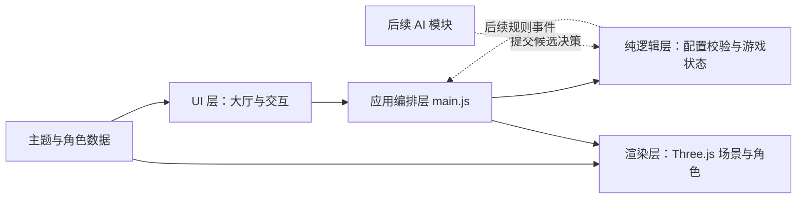

# 口袋大富翁

基于 Three.js + Vite + 原生 JavaScript 的纯前端 3D 大富翁课程项目。代码、注释与文档以中文为主，不依赖后端、外部模型、字体或图片服务。

**当前版本：第①阶段「项目骨架与主菜单」。当前可配置游戏、预览主题与确认队伍，尚不能掷骰游玩完整对局。**

## 本地运行

需要 Node.js 22.12+（本次开发使用 Node.js 24.13.1）以及支持 WebGL 2 的现代浏览器。

```bash
npm install
npm run dev
```

访问终端显示的地址，默认是 `http://127.0.0.1:5173`。首次安装依赖需要网络，运行时不请求外部模型或纹理。

```bash
npm test          # 运行纯逻辑自动测试
npm run build    # 产物输出至 dist
npm run preview  # 检查生产构建
```

## 当前使用方式

1. 切换「欢乐都市 / 童话森林 / 星际旅行」查看不同布局的微缩主题场景。
2. 选择 2–4 人，每个座位独立设为真人或 AI；支持全真人、混合或全 AI 配置。
3. 点击座位，再点击阿橙、小芽、露娜或莓莓。角色已占用时，双方交换角色。
4. 输入 5–100 的整数回合数（默认 30）。点击「集结出发」查看配置摘要。
5. 第①阶段按钮仅创建初始游戏状态并展示摘要；后续阶段才接入真实对局。

## 分层架构



实线表示当前依赖，虚线表示后续扩展。`core` 不导入 Three.js 或 DOM，可直接在 Node.js 中测试。`render` 只负责画面，不裁决金币、胜负和回合。`ui` 收集输入，`main.js` 连接各层。AI 后续仅提出决策，规则层最终验证。

## 功能 → 代码文件 / 函数

| 当前功能 | 文件 | 关键函数或数据 |
| --- | --- | --- |
| 启动与层间协调 | `src/main.js` | `mountMenu` 回调、`onStart` |
| 三种主题配置 | `src/data/maps.js` | `MAPS` |
| 四种角色配置 | `src/data/characters.js` | `CHARACTERS` |
| 默认配置与边界校验 | `src/core/config.js` | `createDefaultConfig`、`validateConfig` |
| 人数增减 | `src/core/config.js` | `setPlayerCount` |
| 角色选择与交换 | `src/core/config.js` | `selectCharacter` |
| 初始化金币、位置和回合 | `src/core/state.js` | `createGameState` |
| 地图、座位、控制方式与回合 UI | `src/ui/menu.js` | `mountMenu`、`refresh` |
| 配置摘要与帮助弹窗 | `src/ui/menu.js` | `showDialog` |
| 代码构建 Q 版角色 | `src/render/character.js` | `createCharacter` |
| 主题微缩场景、动画、尺寸适配 | `src/render/preview.js` | `WorldPreview.update`、`resize` |
| GPU 资源释放 | `src/render/preview.js` | `clearWorld`、`dispose` |
| 响应式布局与角色图标 | `src/styles.css` | 媒体查询、`.avatar-art` |
| 配置与状态回归测试 | `tests/config.test.js` | Node.js 原生测试 |

## 开发阶段与暂停点

| 阶段 | 内容 | 状态 |
| --- | --- | --- |
| ① | 项目骨架、主菜单、场景预览 | 已实现，用户已确认；已补齐负责人讲解材料 |
| ② | 真实棋盘数据、骰子动画、逐格移动、镜头跟随 | 未开始 |
| ③ | `property` 模块、购买、租金、升级、地契 | 未开始 |
| ④ | `event`、`bankrupt` 模块、变卖、结算 | 未开始 |
| ⑤ | `ai` 模块、启发式决策、异常回退 | 未开始 |
| ⑥ | 数字滚动、漂浮文字、音效、动画打磨 | 未开始 |
| ⑦ | 完整真人 / AI 对局测试、文档与交付 | 未开始 |

每阶段完成后暂停交接。第①阶段已有本地中文提交 `95971be`；当前新增交接材料先保留为未提交改动，供负责人检查。参考任务书要求至少 10 次代码签入，后续通过真实功能与修复积累提交。第②阶段在用户要求暂停后尚未修改代码。

## 实验报告与课程要求

- `docs/01-选题说明.md`：选题、NABCD 分析、课程要求核对。
- `docs/02-需求分析.md`：功能范围、验收条件与非功能需求。
- `docs/03-设计文档.md`：分层、状态与后续规则模块规划。
- `docs/04-测试报告.md`：测试用例、预期 / 实际结果与未覆盖范围。
- `docs/05-开发记录.md`：阶段成果、真实修改与待办。
- [团队模块交接与整合约定](docs/07-团队模块交接与整合约定.md)：四人分工、现有接口及后续接入注意事项。

任务书是 2020 年参考文档；时间安排以当前课程通知为准。`要求.txt` 明确提出 GitHub 提交及可运行实体验收，因此最终还需上传仓库并提供公开试玩地址、成员实际贡献记录、真实用户反馈和报告截图。

原始任务书、`要求.txt` 和个人学习用的 `06-你的部分-主菜单与工程讲解.md` 已移至 `E:\code_2\软件工程pro的非项目内容`，不属于项目运行或提交依赖。课程需求摘要及交付文档仍保留在 `docs/`。

## GitHub Pages 部署规划

`vite.config.js` 已设置 `base: './'`，构建资源支持仓库子路径。最终可通过 GitHub Actions 构建并发布 `dist/` 到 Pages。当前尚未创建远程仓库、推送或部署；这些工作将在代码具备完整可玩性之后处理。不要将 `node_modules/` 提交到 Git。
